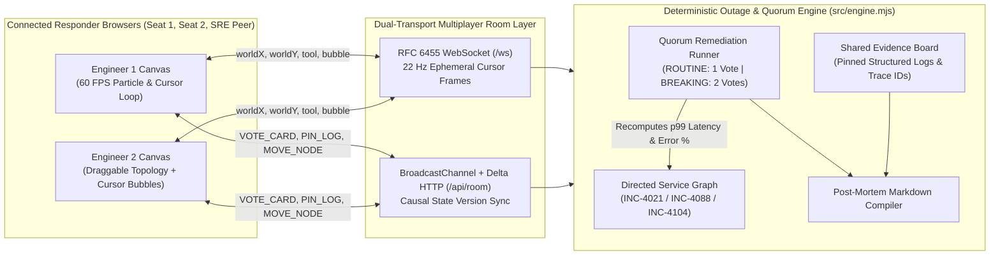

# PulseRoom — Multiplayer Incident War-Room & Live System Topology Canvas

When a production outage hits, debugging usually fractures across isolated browser tabs: one engineer tails logs in a terminal, another stares at Grafana, and people paste half-cropped screenshots into Slack while someone runs a risky command without a second pair of eyes.

**PulseRoom** turns incident response and system architecture triage into a shared, real-time multiplayer war-room. Engineers join the same live room (`?room=WAR-ROOM-01`), see each other's cursors and active inspection tools at 60 FPS on an interactive microservice topology canvas, pin root-cause log lines onto a shared evidence board, and vote on risk-tiered remediation cards (`ROUTINE`, `BREAKING`, `DECISION`) that require multi-engineer quorum before executing against the topology.

---

## Architecture & Multiplayer Sync Flow



---

## Key Multiplayer Features

1. **Real-Time Multiplayer Topology Canvas & Cursor Chat (`/`)**
   - Every responder in the room sees live teammates' cursors normalized to canvas coordinates, their active tool (`Inspect`, `Trace`, `Patch`), and floating cursor speech bubbles (triggered by pressing `/`).
   - Dragging any microservice node (`Edge Ingress`, `API Gateway`, `Checkout API`, `Webhook Dispatcher`, `Postgres Primary`) repositions it live across all connected screens.
   - Directed edges animate packet flow density and health in real time: crimson storm particles (`#f43f5e`) indicate retry storms or connection pool saturation, shifting to emerald (`#10b981`) as remediation cards take effect.

2. **Two-Key Turn: Quorum-Gated Remediation Cards**
   - Inspired by how we review and approve high-risk diffs together in **trmi**, production changes in PulseRoom are modeled as shared approval cards with three risk tiers:
     - `ROUTINE` (1 approval clears — e.g., enabling PgBouncer transaction pooling or Singleflight request coalescing).
     - `BREAKING` (Requires 2-engineer quorum — e.g., throttling `webhook-worker` concurrency and detaching HTTP callbacks from open DB transactions).
     - `DECISION` (Requires 2-engineer quorum — architectural routing trade-offs such as read-replica failover vs. query shedding).
   - Anyone in the room can also propose a custom remediation card (`+ Propose Card`) or veto a dangerous action (`✕ Veto`).

3. **Shared Root-Cause Evidence Pinning**
   - Clicking any node on the topology canvas filters the distributed log stream to that service.
   - Pinning a suspicious log line (`📌 Pin Evidence`) promotes it to the shared Evidence Board with the responder's name and timestamp, building the audit trail as the team investigates.

4. **Three Playable Production Outage Scenarios + Autonomous SRE Peer (`Maya`)**
   - **`INC-4021 (SEV-1)`:** Cascading Postgres Connection Pool Exhaustion caused by webhook workers holding open transactions during external HTTP callbacks.
   - **`INC-4088 (SEV-1)`:** Thundering Herd Cache Stampede on a flash-sale catalog after simultaneous Redis TTL expiry.
   - **`INC-4104 (SEV-2)`:** Split-Brain JWT Signing Key Rotation (`kid=2026-11-a`) across Edge JWKS caches.
   - Includes a **`👥 +2nd Engineer Window`** button for instant side-by-side multi-window testing and an **`🤖 Ask SRE Peer (Maya)`** button that runs an autonomous teammate cursor to inspect degraded nodes, pin unpinned root-cause logs, and cast the second quorum vote when testing solo.

5. **One-Click Collaborative Post-Mortem Export**
   - Generates a complete Markdown post-mortem (`📋 Post-Mortem`) containing MTTR, responders present, pinned log evidence, quorum-approved commands, and the full room audit timeline.

---

## Engineering Notes & Trade-Offs

- **Separating Ephemeral Cursor Telemetry from Causal Room Mutations:**
  Cursor frames fire every ~45 ms (`22 Hz`), whereas voting on a `BREAKING` remediation card or pinning evidence mutates shared state (`stateVersion`). Instead of Incrementing `stateVersion` on every mouse move—which would cause unnecessary DOM re-renders of the vote cards and log list—we route cursor coordinates through a lightweight `CURSOR_UPDATE` frame that only updates the 60 FPS canvas loop and presence header, reserving full `ROOM_STATE` diffs for structural actions (`VOTE_CARD`, `PIN_LOG`, `MOVE_NODE`, `PROPOSE_CARD`, `CHAT`).
- **Zero-Dependency RFC 6455 WebSocket Server + Cloudflare Worker Compatibility:**
  To make sure the app starts in under a second inside `trmi`'s local preview without native binary build issues, `server.mjs` implements the RFC 6455 WebSocket handshake and frame encoder/decoder directly on Node's built-in `node:http` and `node:crypto` modules, sharing `src/engine.mjs` and `src/ui.mjs` with `worker.mjs` for edge deployment.

---

## How We Built It in `trmi`

We organized development inside **trmi** using `main` for shared room contracts (`.termi/decisions.md` and `.termi/gotchas.md`) and separate **lanes** for the deterministic scenario engine (`src/scenarios.mjs`, `src/engine.mjs`) and the interactive canvas UI (`src/ui.mjs`), reviewing and approving card diffs together before merging into `main`.

---

## Running Locally

```bash
# 1. Start the multiplayer war-room server (zero external npm dependencies required)
npm run dev
# -> ⚡ PulseRoom Multiplayer War-Room running at http://localhost:4321

# 2. Run the automated 2-engineer quorum & state sync test suite
npm test
```

Open `http://localhost:4321` and click **`👥 +2nd Engineer Window`** in the top bar to open a second responder seat side by side.
